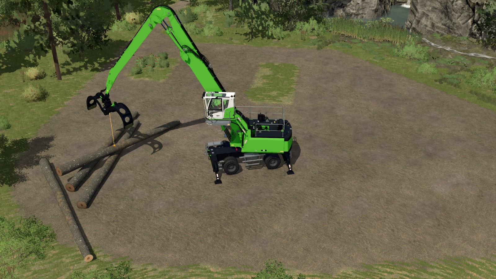
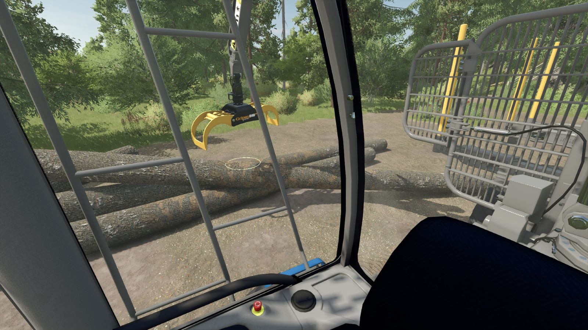
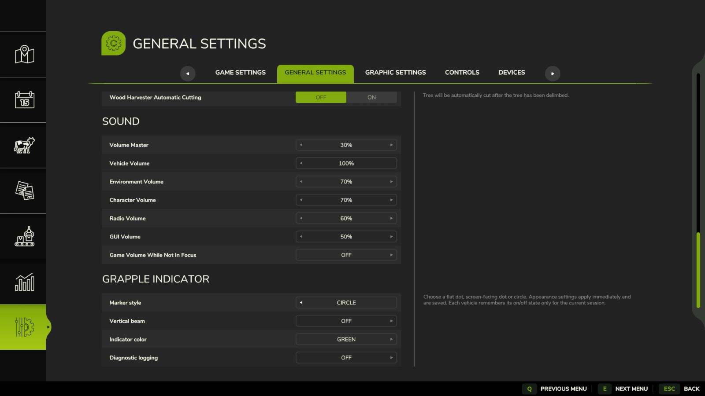

# Grapple Indicator

A Farming Simulator 25 mod that adds a customizable position indicator for supported log grapples on the controlled vehicle and its attachments.

## Features

- Toggle a marker beneath the tracked grapple with **Left Ctrl + G**.
- Choose a flat dot, screen-facing dot, or circle.
- Customize the indicator color and enable an optional vertical beam.
- Save appearance settings between sessions.
- Remember each vehicle's indicator on/off state during the current session.
- Multiplayer support: each player controls their own indicator, which other players cannot see.
- English, German, and French translations.

## Usage

Enter a vehicle with a supported log grapple and press **Left Ctrl + G** to toggle the indicator. The toggle is available only when a supported grapple is detected.

Open **General Settings → Grapple Indicator** to change the marker style, color, and vertical beam. Diagnostic logging can also be enabled there for troubleshooting.

## Screenshots

Position indicator with the vertical beam enabled.

Circle marker viewed from inside the cab.

Customize the indicator in General Settings.

## Installation from source

1. Download or clone this repository.
2. Create a ZIP named `FS25_GrappleIndicator.zip` containing `modDesc.xml`, `icon_GrappleIndicator.dds`, and the `scripts` folder. Place `modDesc.xml` directly at the ZIP root, with no enclosing folder.
3. Place the ZIP in your Farming Simulator 25 mods folder.
4. Enable **Grapple Indicator** when loading your savegame.

## Changelog

### 1.0.1.0

- Added multiplayer support with independent player preferences.

## Feedback

Report bugs and suggest improvements through [GitHub Issues](https://github.com/welnim/FS25_GrappleIndicator/issues). For detection problems, include the vehicle or grapple name, steps to reproduce the issue, and relevant diagnostic output from `log.txt`.

## Author

Welnim

## License

Licensed under the [GNU General Public License v3.0](LICENSE).
